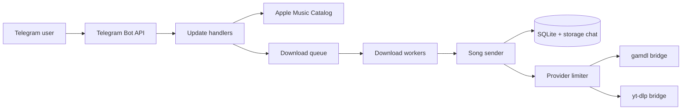

<h1 align="center">Apple Music Downloader Telegram Bot</h1>

<p align="center">
  Search Apple Music, download tracks, albums, and playlists from Telegram.<br/>
  Metadata always comes from Apple Music; audio can come from Apple Music or YouTube.
</p>

<p align="center">
  
  
  
  
  <a href="LICENSE"></a>
</p>

## Contents

- [Features](#features)
- [Tech Stack](#tech-stack)
- [Quick Start](#quick-start)
- [Requirements](#requirements)
- [Setup](#setup)
- [Configuration](#configuration)
- [How It Works](#how-it-works)
- [Usage](#usage)
- [Seeding popular artists](#seeding-popular-artists)
- [Troubleshooting](#troubleshooting)
- [Project Layout](#project-layout)
- [License](#license)

## Features

- Inline search in any Telegram chat.
- Search songs, albums, artists, and playlists, or paste an Apple Music URL.
- Download single tracks and full albums/playlists with metadata.
- Queue with positions, cancellation, and a per-request progress message.
- Parallel downloads with a global provider limit and a configurable cooldown.
- Cache in SQLite plus a Telegram storage chat, so repeat requests are instant.
- Pluggable audio providers: Apple Music (`gamdl`) or YouTube (`yt-dlp`).
- Webhook and long-polling modes.
- Optional local Telegram Bot API server for larger files.
- EF Core migrations run automatically on startup.

> The bot is designed to run as a **single instance**. Cache-miss downloads are protected by an in-process keyed lock. Horizontal scaling would require a distributed lock or database claim.

## Tech Stack

| Layer | Technology |
|---|---|
| Application | ASP.NET Core on .NET 10 |
| Telegram | Telegram.Bot (custom fork) |
| Catalog | Apple Music Catalog API (JWT) |
| Database | SQLite via EF Core |
| Audio providers | Python 3.12, gamdl 3.7.4, yt-dlp + Deno |
| Infrastructure | Docker Compose |
| Validation | FluentValidation |

## Quick Start

```bash
git clone https://github.com/frytech/AppleMusic-Downloader-Telegram-Bot.git
cd AppleMusic-Downloader-Telegram-Bot

cp .env.example .env
# Fill in the required values (see below)

docker compose up -d --build
docker compose logs -f applemusic-bot
```

Minimal `.env` (YouTube mode):

```dotenv
TELEGRAM__BOT_TOKEN=123456:ABC...
TELEGRAM__STORAGE_CHAT_ID=-100...
APPLE_MUSIC__API_TOKEN=eyJ...

DOWNLOADER__PROVIDER=ytdlp
DOWNLOADER__YTDLP__COOKIES_PATH=/app/data/youtube_cookies.txt
```

For Apple Music audio, set `DOWNLOADER__PROVIDER=gamdl` and point `DOWNLOADER__GAMDL__COOKIES_PATH` at your Apple cookies. The JWT token is required in both modes. The `ytdlp` provider downloads audio from YouTube and tags it with public Apple Music catalog metadata and cover art. It does not require an Apple Music subscription, Apple cookies, or lyrics.

## Requirements

| Requirement | Needed for | Notes |
|---|---|---|
| Telegram bot token | everything | Create one via [@BotFather](https://t.me/BotFather). |
| Telegram storage chat | everything | Private group or channel where the bot can upload cached audio. Add the bot as an admin and use the numeric chat ID (`-100...`). |
| Apple Music JWT token | everything | Used for search, metadata, and cache IDs. |
| Apple Music subscription + Apple cookies | `gamdl` | Required to decrypt Apple Music `.m4a` files. |
| YouTube cookies | `ytdlp` | Optional but strongly recommended. Use a dedicated account. |
| Docker + Docker Compose | everything | `ffmpeg`, Python, and Deno are included in the image. |

## Setup

### 1. Telegram

1. Create a bot via [@BotFather](https://t.me/BotFather) and copy its token into `TELEGRAM__BOT_TOKEN`.
2. Create a private group or channel for cached files.
3. Add the bot as an administrator so it can upload audio.
4. Put its numeric chat ID into `TELEGRAM__STORAGE_CHAT_ID`.

### 2. Apple Music JWT

1. Sign in at [music.apple.com](https://music.apple.com).
2. Open DevTools (`F12`) and switch to the **Console** tab.
3. Run:

```js
MusicKit.getInstance().developerToken
```

4. Copy the token into `APPLE_MUSIC__API_TOKEN`.

The token expires periodically. Refresh it when searches start failing with `401` responses.

### 3. Cookies

Keep Apple and YouTube cookies in separate files. The provided `.env.example` uses:

```text
data/bot/apple_cookies.txt
data/bot/youtube_cookies.txt
```

Both map to `/app/data/...` inside the container. If you prefer a single file, the compose defaults use `/app/data/cookies.txt`, but separate files avoid accidental overwrites when switching providers.

The `ytdlp` provider uses only its own cookies for YouTube. Apple Music metadata and cover art are fetched by the bot through the public catalog API, so no Apple cookies are needed for `ytdlp`.

Keep `.env` and cookie files out of version control. Both are excluded by the repository's `.gitignore`.

#### Apple Music cookies (`gamdl`)

Export Netscape cookies from a signed-in [music.apple.com](https://music.apple.com) session (for example with [cookies.txt](https://github.com/kairi003/Get-cookies.txt-LOCALLY)) and save them as `data/bot/apple_cookies.txt`. The account must have an active Apple Music subscription.

#### YouTube cookies (`ytdlp`)

YouTube cookies are optional but improve reliability. Use a dedicated Google account that you do not use in a browser afterwards, and export Netscape cookies from the same egress IP as the bot to `data/bot/youtube_cookies.txt`.

The bridge gives each yt-dlp process a temporary copy of the jar and merges updated cookies back under a lock, so rotation is preserved during parallel downloads. If the session expires, replace the file with a fresh export.

### 4. Run

```bash
docker compose up -d --build
```

The SQLite database is created automatically at `./data/bot/app.db`.

### 5. Local Bot API (optional)

The local Bot API server lifts the public Bot API file-size limit.

1. Get `api_id` and `api_hash` from [my.telegram.org](https://my.telegram.org/apps).
2. Add to `.env`:

```dotenv
TELEGRAM_API_ID=123456
TELEGRAM_API_HASH=...
TELEGRAM__SERVER_API_URL=http://telegram-bot-api:8081
```

3. Start with the profile:

```bash
docker compose --profile local-api up -d --build
```

### 6. Webhook mode (optional)

By default the bot uses long polling. To use webhooks:

```dotenv
TELEGRAM__WEBHOOK__ENABLED=true
TELEGRAM__WEBHOOK__URL=https://example.com
TELEGRAM__WEBHOOK__PATH=/api/bot/update
TELEGRAM__WEBHOOK__SECRET_TOKEN=change-me
```

The URL must be publicly reachable and routed to the bot on port `8080`.

## Configuration

The bot container loads `.env` through `env_file`, so every variable listed below is passed without a per-key mapping in `docker-compose.yml`.

### Core

| Variable | Required | Default | Description |
|---|:---:|---|---|
| `TELEGRAM__BOT_TOKEN` | Yes | — | Bot token from BotFather. |
| `TELEGRAM__STORAGE_CHAT_ID` | Yes | — | Chat ID used to cache uploaded audio. |
| `APPLE_MUSIC__API_TOKEN` | Yes | — | Apple Music JWT developer token. |
| `APPLE_MUSIC__DEFAULT_STORE` | No | `us` | Storefront used for search and metadata (`us`, `kz`, `ru`, ...). |
| `APPLE_MUSIC__STORE_API_URL` | No | `https://amp-api-edge.music.apple.com/v1/` | Apple Music Catalog API base URL. |
| `DOWNLOADER__PROVIDER` | No | `gamdl` | `gamdl` for Apple Music or `ytdlp` for YouTube. |
| `DOWNLOADER__GAMDL__COOKIES_PATH` | `gamdl` | `/app/data/cookies.txt` | Apple Music cookies file. |
| `DOWNLOADER__YTDLP__COOKIES_PATH` | No | `/app/data/cookies.txt` | Optional YouTube cookies file. |
| `DOWNLOADER__PROCESS_TIMEOUT_SECONDS` | No | `300` | Timeout for a provider subprocess. |

### Downloads and queue

| Variable | Default | Description |
|---|---:|---|
| `DOWNLOADER__MAX_CONCURRENCY` | `3` | Maximum simultaneous provider calls, and maximum songs downloaded in parallel within one request. |
| `DOWNLOADER__DELAY_AFTER_DOWNLOAD_SECONDS` | `3` | Cooldown after each provider attempt, including failures. |
| `TELEGRAM__DOWNLOADS__MAX_CONCURRENCY` | `2` | Number of download requests processed in parallel. |
| `TELEGRAM__DOWNLOADS__MAX_PENDING_SONGS` | `2000` | Soft cap on total songs waiting in the queue. |
| `TELEGRAM__DOWNLOADS__MAX_PENDING_BULK_PER_USER` | `1` | Maximum pending album/playlist requests per user. |
| `TELEGRAM__DOWNLOADS__MAX_SONGS_PER_BATCH` | `250` | Maximum songs queued by one album/playlist batch request. Must be between 1 and 250. |
| `TELEGRAM__DOWNLOADS__SONGS_PAGE_SIZE` | `250` | Apple Music tracks page size. Must be between 1 and 250. |
| `TELEGRAM__PROGRESS_UPDATE_INTERVAL_SECONDS` | `2` | Minimum interval between progress message edits (`0` = every song). |

**Two different concurrency limits:**

- `TELEGRAM__DOWNLOADS__MAX_CONCURRENCY` controls how many download **requests** run at once.
- `DOWNLOADER__MAX_CONCURRENCY` controls how many **provider calls** run at once and how many songs inside one request download in parallel.
- A provider slot cools down for `DOWNLOADER__DELAY_AFTER_DOWNLOAD_SECONDS` after each attempt.

### Telegram API and webhook

| Variable | Default | Description |
|---|---|---|
| `TELEGRAM__SERVER_API_URL` | `https://api.telegram.org` | Telegram API endpoint. Use `http://telegram-bot-api:8081` with the `local-api` profile. |
| `TELEGRAM__WEBHOOK__ENABLED` | `false` | Enable webhook mode. |
| `TELEGRAM__WEBHOOK__URL` | — | Public webhook URL. Required when webhooks are enabled. |
| `TELEGRAM__WEBHOOK__PATH` | `/api/bot/update` | Webhook route. |
| `TELEGRAM__WEBHOOK__SECRET_TOKEN` | — | Optional Telegram secret token. |
| `TELEGRAM__WEBHOOK__MAX_CONNECTIONS` | `50` | Maximum simultaneous webhook connections. |
| `TELEGRAM_API_ID` | — | Local Bot API only. |
| `TELEGRAM_API_HASH` | — | Local Bot API only. |
| `LOGGING__LOGLEVEL__DEFAULT` | `Debug` | Log level. |

Compose mounts are controlled by `BOT_DATA_PATH` (default `./data/bot`) and `TG_DATA_PATH` (default `./data/telegram`).

## How It Works



1. Telegram delivers a message, inline query, or callback to the update handlers.
2. Search results, metadata, and cache IDs always come from the Apple Music Catalog API.
3. Downloads are placed in a queue. Each request is processed by a worker; songs inside a request run in parallel up to `DOWNLOADER__MAX_CONCURRENCY`.
4. The cache is checked first. On a miss, the selected provider produces the audio file.
5. The file is uploaded to the storage chat, cached in SQLite, and sent to the user.
6. Failed tracks are reported and are not cached, so a later request can retry them.

Finished batches are sent in the original track order. The progress message shows `Songs processed: X of Y` and adds `(N failed)` only when at least one track failed.

## Usage

### Inline search

```text
@YourBotName Imagine Dragons
@YourBotName song:Bohemian Rhapsody
@YourBotName album:Dark Side of the Moon
@YourBotName artist:The Weeknd
@YourBotName playlist:Chill
```

### Search modes

| Prefix | Mode | Description |
|---|---|---|
| *(none)* or `all:` | All | Songs, albums, artists, and playlists. |
| `song:` | Songs | Songs only. |
| `album:` | Albums | Albums only. |
| `artist:` | Artists | Artists only. |
| `playlist:` | Playlists | Playlists only. |
| `album-songs:` | Album tracks | All songs in an album. |
| `playlist-songs:` | Playlist tracks | All songs in a playlist. |
| `artist-songs:` | Artist tracks | All songs by an artist. |
| `artist-albums:` | Artist albums | All albums by an artist. |
| `artist-playlists:` | Artist playlists | Playlists featuring an artist. |

### Apple Music URLs

Paste a link directly into the chat:

```text
https://music.apple.com/us/album/after-hours/1499378108
https://music.apple.com/us/song/blinding-lights/1499378115
```

The bot detects songs, albums, artists, and playlists.

### Buttons and progress

After a result appears, use the inline buttons to download a song, download a whole album/playlist, or browse an artist. Albums and playlists are queued in batches of up to 250 tracks; when more tracks are available, use the **Load next 250 songs** button to continue. While a bulk download runs, the status message shows the queue position and progress. A **Cancel** button stops the request; tracks already downloaded are still sent.

### Commands

| Command | Description |
|---|---|
| `/start` | Welcome message with quick actions. |

## Seeding popular artists

The bot can pre-fill its cache from an artist list. For each artist it finds the Apple Music artist, walks studio albums and singles, filters out live/remix/deluxe/compilation releases, and downloads every remaining track into the normal cache (SQLite + storage chat). No Telegram messages are needed.

The default list is `data/artists.txt`, ordered by popularity. Sources: ListenBrainz sitewide all-time top artists plus the Last.fm HetRec 2011 dataset aggregated by listen count. You can edit it or point `SEED__ARTISTS_FILE` at your own list. With Docker Compose, `data/artists.txt` resolves to `/app/data/artists.txt` inside the container and to `./data/bot/artists.txt` on the host.

Each line is either an artist name or `artist name | Apple Music artist ID or URL`:

```text
The Beatles
Ye | 2715720
Queen | https://music.apple.com/kz/artist/queen/32940
```

Lines starting with `#` and blank lines are ignored. The optional second column pins ambiguous names to a specific Apple Music artist. If the ID or URL cannot be parsed, the artist is still processed by name and a warning is logged.

### Quick smoke test

The seeder runs as a background hosted service; the old `--seed` CLI flag no longer exists. To run it one-shot, start the container with seeding enabled and stop it when done:

```bash
docker compose run --rm \
  -e SEED__ENABLED=true \
  -e SEED__MAX_ARTISTS=1 \
  -e SEED__MAX_SONGS=3 \
  -e SEED__EXIT_WHEN_DONE=true \
  applemusic-bot
```

The artist is left as `partial` in `data/seed-state.json`, so a later full run will continue it.

### First run: 50 artists

Stop the bot first so the seeder is the only process writing to SQLite:

```bash
docker compose stop applemusic-bot

docker compose run --rm \
  -e SEED__ENABLED=true \
  -e SEED__MAX_ARTISTS=50 \
  -e SEED__EXIT_WHEN_DONE=true \
  applemusic-bot

docker compose up -d applemusic-bot
```

Useful settings for the first run:

```dotenv
SEED__PROVIDER=gamdl
SEED__ARTISTS_FILE=data/artists.txt
DOWNLOADER__GAMDL__COOKIES_PATH=/app/data/apple_cookies.txt
DOWNLOADER__MAX_CONCURRENCY=6
DOWNLOADER__DELAY_AFTER_DOWNLOAD_SECONDS=0
SEED__CONCURRENCY=8
SEED__CATALOG_CONCURRENCY=4
```

`SEED__PROVIDER=gamdl` makes the seeder use gamdl while normal bot requests keep using `DOWNLOADER__PROVIDER`. If you want everything on gamdl, set `DOWNLOADER__PROVIDER=gamdl` as well.

### Full run

After the first 50 look good:

```bash
docker compose stop applemusic-bot

docker compose run --rm \
  -e SEED__ENABLED=true \
  -e SEED__MAX_ARTISTS=0 \
  -e SEED__EXIT_WHEN_DONE=true \
  applemusic-bot

docker compose up -d applemusic-bot
```

`SEED__MAX_ARTISTS=0` means all artists. Already processed artists are skipped from `data/seed-state.json`.

### Background mode

To keep the bot online while seeding, set:

```dotenv
SEED__ENABLED=true
SEED__MAX_ARTISTS=50
```

Then `docker compose up -d --build`. The seeder shares the provider limiter with normal bot downloads, so user requests may be slower while it runs.

### Progress, stop, resume

- Progress is saved after each artist to `data/seed-state.json`.
- Unmatched artists are written to `data/seed-unmatched-artists.txt`, failed tracks to `data/seed-failed-songs.txt`.
- `data/seed.lock` prevents two seeder instances from running at the same time.
- Stop with `Ctrl+C` or `docker compose stop applemusic-bot`; rerun the same command to continue.
- A circuit breaker stops the run after `SEED__MAX_CONSECUTIVE_FAILURES` failures in a row (expired gamdl cookies, missing subscription, or rate limits).

### Filters and scale

By default only studio albums and singles/EPs are used. Live, remix, deluxe, compilation, greatest-hits, demo, rehearsal, instrumental, karaoke, and tour releases are excluded via `SEED__EXCLUDE_ALBUM_PATTERNS`. Remastered editions are kept because they are often the only available version of a studio album. Track-level markers are filtered via `SEED__EXCLUDE_TRACK_PATTERNS`. Remove patterns if you want a broader crawl.

Seeding all 5000 artists can produce hundreds of thousands of tracks and take days or weeks. Start with 50, watch the logs and storage chat size, then increase. If you see `403`/`429`, lower `DOWNLOADER__MAX_CONCURRENCY` and `SEED__CONCURRENCY`.

## Troubleshooting

| Symptom | Fix |
|---|---|
| Apple Music search fails with `401` | Refresh `APPLE_MUSIC__API_TOKEN`. |
| `gamdl` download fails | Check the Apple Music subscription and `apple_cookies.txt`. |
| `yt-dlp` tags differ from `gamdl` | Expected: without an Apple Music subscription, `ytdlp` omits lyrics, sort fields, `disc_total`, `rating` (unless the catalog provides it), `comments`, `gapless`, `storefront`, and `xid`. |
| `yt-dlp`: `Sign in to confirm you're not a bot` | Refresh YouTube cookies, use a dedicated account, and make sure the browser and bot use the same egress IP. A flagged datacenter IP may still need a proxy. |
| YouTube cookies expire after a while | Replace `youtube_cookies.txt` with a fresh export. The bridge persists rotation, but sessions can still be invalidated. |
| `telegram-bot-api:8081` name not known | Use the public API, or start the `local-api` profile and set `TELEGRAM__SERVER_API_URL`. |
| Webhook is not configured | Check `TELEGRAM__WEBHOOK__URL` reachability, the secret token, and that port `8080` is exposed. Long polling works without a webhook. |
| Queue is full | Wait for pending downloads or raise `TELEGRAM__DOWNLOADS__MAX_PENDING_SONGS`. |
| Duplicate downloads | Run only one bot instance. |

## Project Layout

```text
.
├── src/
│   ├── python/
│   │   ├── gamdl-bridge.py
│   │   └── ytdlp-bridge.py
│   └── frytech.AppleMusicTools.Downloader.TelegramBot/
│       ├── Configuration/
│       ├── Services/          # Caching, Catalog, Downloads, Requests, SongFiles
│       ├── Telegram/
│       └── Program.cs
├── data/
│   ├── bot/                   # app.db, cookies, artists.txt, seed state
│   └── telegram/              # local Bot API data
├── .env.example
├── docker-compose.yml
├── docker-compose.override.yml
├── Dockerfile
└── LICENSE
```

## License

MIT. See [LICENSE](LICENSE).

This project is not affiliated with Apple Inc. Use it only for content you are allowed to download, and respect the terms of service and copyright law.
